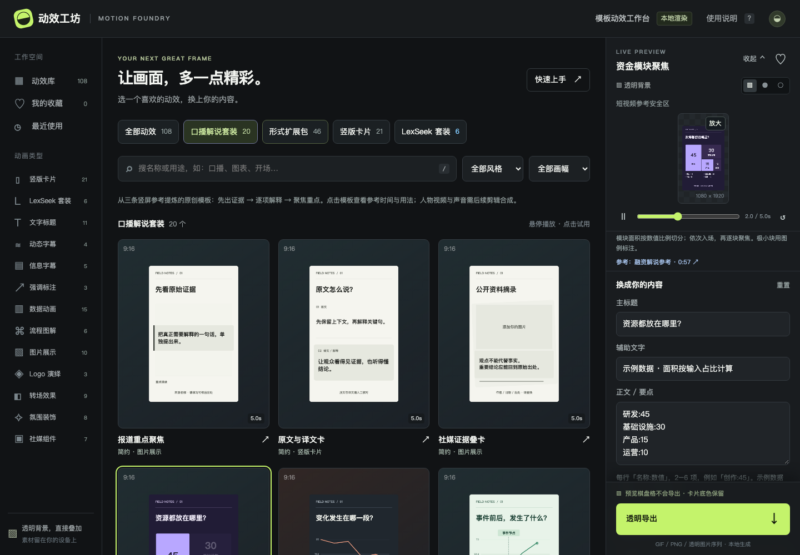

# Motion Foundry · 动效工坊

**选一个模板，换成你的内容，导出可以叠进视频的动画。**

Motion Foundry 是面向视频创作者的浏览器端二维动效工作台。无需使用 After Effects，也无需从空白时间线开始：通过模板制作标题、竖版信息卡、数据图表、解说包装和转场覆盖层。

纯静态网站 · 无需账号或后端 · 本地渲染与导出 · MIT 许可



### 🚀 在线试用（无需安装）

👉 **[打开 Motion Foundry 在线工作台](https://william0116.github.io/motion-foundry/)** — GitHub Pages 托管的演示站，直接选模板、改内容、导出动画。

[快速开始](#快速开始) · [功能与导出](#功能与导出) · [使用指南](docs/usage.md) · [开发文档](docs/development.md) · [部署](docs/deployment.md) · [参与贡献](CONTRIBUTING.md)

## 为什么做这个项目

在口播、知识分享和产品介绍视频里，一个数字增长、一张观点卡或一段重点标注，往往比复杂的特效更有用。Motion Foundry 将这些常见表达做成可修改、可预览、可重复使用的模板，让创作者把时间花在内容上。

它是**动效素材生成工具**，不是视频剪辑器、AI 自动剪辑服务或完整的 AE 替代品。预览与导出共用 Canvas 渲染器；不读取或生成 `.aep` 工程。

## 功能与导出

- **108 个模板、13 个分类**：文字标题、动态字幕、信息字幕、强调标注、数据动画、流程图解、图片展示、竖版卡片、品牌套装、Logo 演绎、转场、氛围装饰、社媒组件。
- **适合竖屏内容**：47 个模板默认采用 9:16；所有模板均可切换 16:9、9:16、1:1。默认竖屏与“竖版卡片”分类是不同统计维度。
- **直接编辑内容**：标题、说明、正文、数据和本地图片；不同模板开放不同字段，并校验格式与条数。
- **7 种配色方案**：自由配色、黑白、杏橘、紫夜、薄荷及 LexSeek 亮／暗方案。品牌配色是可选项，不会接管全站主题。
- **实时预览**：播放、拖动进度、检查深浅背景、参考安全区、折叠或放大预览；支持收藏、最近使用和用途搜索。
- **本地导出**：生成过程有进度提示，可取消并重试。上传的图片在浏览器中处理，不发送到应用服务器。

| 输出格式     | 可选参数                                  | 适用场景与透明能力                                    |
| ------------ | ----------------------------------------- | ----------------------------------------------------- |
| PNG 单帧     | 短边 720 / 1080 px                        | 当前画面；完整 RGBA 透明度                            |
| PNG 序列 ZIP | 短边 720 / 1080 px；24 / 25 / 30 fps      | 视频叠加首选；完整 RGBA，含帧文件、参数清单和导入说明 |
| GIF          | 短边 360 / 480 / 720 px；10 / 15 / 20 fps | 循环预览与分享；透明、白底或黑底                      |

**GIF 不支持半透明。** 透明 GIF 使用二值透明，阴影、光晕与抗锯齿边缘可能变硬；每帧最多 256 色。需要干净的透明视频叠加时，请优先用 PNG 序列。画布棋盘格和安全区不会导出，但卡片本身的面板底色会保留。

### 当前边界

- 尚不支持 MOV / ProRes 4444、MP4、音频、SRT、语音识别、自动抠像、视频上传或多轨剪辑；界面中的 MOV 选项不可用。
- 动态字幕采用固定节奏，装饰波形不随音频变化。转场是覆盖层，不会扭曲或处理底层视频。
- 收藏和最近使用保存在当前浏览器的 `localStorage`；编辑内容与图片仅在内存中，刷新会丢失。没有项目保存、数据库或多人同步。
- 字体依赖本机字体；不同操作系统可能有排版差异。当前自动化回归针对 Chromium，不代表所有浏览器已认证兼容。

## 快速开始

从本仓库下载 ZIP 并解压，或复制仓库页面的克隆地址：

```sh
git clone <本仓库的克隆地址> motion-foundry
cd motion-foundry
```

### 只想使用：无需安装前端依赖

安装 Python 3 后，在仓库根目录运行：

```sh
python3 -m http.server 4173 --bind 127.0.0.1 --directory dist
```

打开 [http://127.0.0.1:4173](http://127.0.0.1:4173)。Windows 可将 `python3` 换成 `py -3`。

也可以使用 **Node.js 22 或更高版本**，同样无需先安装依赖：

```sh
npm start
```

不要直接双击 `index.html`：浏览器的 ES Modules 需要通过 HTTP 服务加载。`dist/` 就是手工维护的应用源码及部署目录，**不是可以删除后重新构建的产物**。

### 开始制作

1. 从分类或合集中选择模板，按需切换画幅。
2. 替换文案、数据或图片，调整配色、位置与时长。
3. 拖动预览进度，检查长文案、画面边缘和透明区域。
4. 选择 GIF 或 PNG 导出；使用 PNG 序列时，按导出帧率导入支持图片序列的剪辑软件。

详见[使用与导出指南](docs/usage.md)，包含图片限制、透明背景说明和常见问题。

## 开发与验证

应用没有框架和构建步骤。Node.js 仅用于本地开发、格式化与自动化测试；生产运行不需要 Node.js。

```sh
npm ci
npx playwright install chromium
npm run check
npm test
npm run test:browser
```

浏览器测试会自行启动隔离的本地服务，验证真实文件下载、导出异常恢复、取消、移动端导出对话框及 `/qa.html` 渲染回归，输出保存在被 Git 忽略的 `test-results/`。Linux 环境若缺少浏览器系统依赖，可使用 `npx playwright install --with-deps chromium`。

已有 Chrome 的开发者可以用 `MOTION_BROWSER_CHANNEL=chrome npm run test:browser`（POSIX shell）。完整说明见[开发与测试](docs/development.md)。测试通过不等同于对所有剪辑软件的导入兼容性保证。

## 工程结构

```text
motion-foundry/
├── dist/                     # 应用源码；整个目录可作为静态网站部署
│   ├── index.html            # 工作台入口
│   ├── workbench.js          # 页面状态、预览与导出交互
│   ├── data.js               # 模板汇总、默认值与输入校验
│   ├── *-effects.js          # 扩展模板定义
│   ├── renderer.js           # 统一 Canvas 渲染入口
│   ├── *-renderer.js         # 卡片、图解及解说模板渲染
│   ├── schemes.js            # 可选配色
│   ├── exporter.js           # PNG、ZIP 与元数据
│   ├── gif-exporter.js       # GIF 编码适配
│   ├── qa.html / *-tests.js   # 浏览器渲染与导出校验
│   └── vendor/gifenc/        # 随项目分发的 MIT 编码器
├── scripts/                  # 本地静态服务与工程检查
├── tests/                    # Node、浏览器及可选的独立解码测试
├── docs/                     # 使用、架构、扩展、部署与发布检查
├── CONTRIBUTING.md
├── SECURITY.md
├── THIRD_PARTY_NOTICES.md
└── LICENSE
```

## 部署与模板更新

将 **`dist/` 的完整内容**放入静态服务器的网站目录即可，不需要数据库、环境变量或应用服务端。不要把仓库根目录作为站点根目录，也不要上传 `.git/`、测试输出或开发依赖。

本仓库约定 `main` 用于开发，`prod` 用于经过确认的发布。新增模板目前随代码更新：合入开发分支、完成测试与审查后，再将 `prod` 快进至指定提交并部署。没有在线模板后台或数据库迁移步骤。

缓存策略、子路径部署和回滚流程见[部署与发布](docs/deployment.md)。

## 参与贡献

欢迎改进模板、中文排版、导出可靠性、无障碍体验和测试。新增模板请同时提供输入边界、三种画幅及透明区域的验证。

- [贡献指南](CONTRIBUTING.md)：提交范围、代码风格与审查清单。
- [模板扩展指南](docs/templates.md)：模板字段、渲染约定及接入示例。
- [架构与测试](docs/development.md)：模块职责、运行命令与测试分层。
- [安全政策](SECURITY.md)：安全问题的报告方式及数据处理边界。

## 许可与致谢

项目代码以 [MIT License](LICENSE) 发布。第三方依赖保留各自许可证，详见[第三方声明](THIRD_PARTY_NOTICES.md)。

GIF 编码使用 [gifenc](https://github.com/mattdesl/gifenc)。模板设计参考了常见的标题、卡片、图表和解说信息组织方式；研究来源与使用边界见[设计参考](docs/design-references.md)。项目未随附参考视频、商业模板、付费字体或讲解者肖像。上传素材的使用权由使用者自行确认；代码许可不授予第三方商标或品牌使用权。
