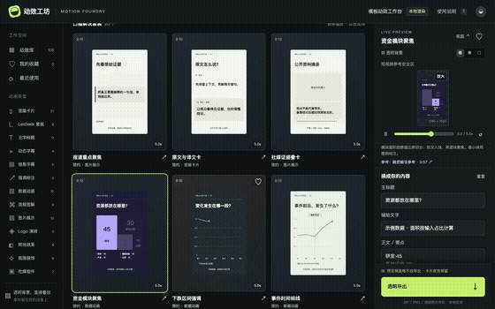
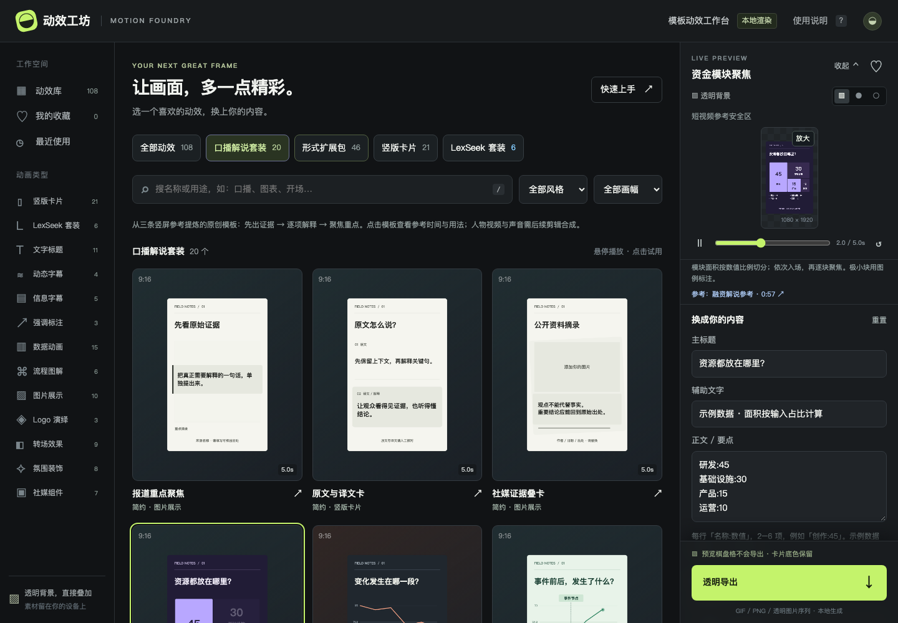

# Motion Foundry · 动效工坊

[](https://github.com/william0116/motion-foundry/actions/workflows/ci.yml)
[](LICENSE)
[](https://william0116.github.io/motion-foundry/)

**选一个模板，换成你的内容，导出可以叠进视频的动画。**

Motion Foundry 是面向视频创作者的浏览器端二维动效工作台。无需使用 After Effects，也无需从空白时间线开始：通过模板制作标题、竖版信息卡、数据图表、解说包装和转场覆盖层。

纯静态网站 · 无需账号或后端 · 本地渲染与导出 · MIT 许可

<table>
  <tr>
    <td width="50%"></td>
    <td width="50%"></td>
  </tr>
  <tr>
    <td align="center"><sub>导出成品：透明动效直接叠加进视频</sub></td>
    <td align="center"><sub>操作过程：悬停预览 → 选中 → 编辑</sub></td>
  </tr>
</table>



### 🚀 在线试用（无需安装）

👉 **[打开 Motion Foundry 在线工作台](https://william0116.github.io/motion-foundry/)** — GitHub Pages 托管的演示站，直接选模板、改内容、导出动画。

[快速开始](#快速开始) · [功能与导出](#功能与导出) · [浏览器 AI 工具](#浏览器-ai-工具webmcp) · [使用指南](docs/usage.md) · [开发文档](docs/development.md) · [部署](docs/deployment.md) · [参与贡献](CONTRIBUTING.md)

## 为什么做这个项目

在口播、知识分享和产品介绍视频里，一个数字增长、一张观点卡或一段重点标注，往往比复杂的特效更有用。Motion Foundry 将这些常见表达做成可修改、可预览、可重复使用的模板，让创作者把时间花在内容上。

它是**动效素材生成工具**，不是视频剪辑器、AI 自动剪辑服务或完整的 AE 替代品。预览与导出共用 Canvas 渲染器；不读取或生成 `.aep` 工程。

## 功能与导出

- **108 个模板、13 个分类**：文字标题、动态字幕、信息字幕、强调标注、数据动画、流程图解、图片展示、竖版卡片、品牌套装、Logo 演绎、转场、氛围装饰、社媒组件。
- **适合竖屏内容**：47 个模板默认采用 9:16；所有模板均可切换 16:9、9:16、1:1。默认竖屏与“竖版卡片”分类是不同统计维度。
- **直接编辑内容**：标题、说明、正文、数据和本地图片；不同模板开放不同字段，并校验格式与条数。
- **7 种配色方案**：自由配色、黑白、杏橘、紫夜、薄荷及 LexSeek 亮／暗方案。品牌配色是可选项，不会接管全站主题。
- **实时预览**：播放、拖动进度、检查深浅背景、参考安全区、折叠或放大预览；支持收藏、最近使用和用途搜索。
- **自定义时长**：1–10 秒滑杆（0.5 秒步长），不再局限于固定档位。
- **撤销 / 重做**：编辑文案、数据与样式时支持 `Ctrl/Cmd + Z` 撤销、`Ctrl/Cmd + Shift + Z` 重做，也有对应按钮。
- **工程保存**：把当前配置（含已上传图片）保存到本浏览器 `IndexedDB`，随时打开、重命名或删除；不上云、不同步。
- **离线可用**：作为 PWA 安装后，静态资源缓存到本地，无网络也能打开工作台（导出全部在本机完成）。
- **本地导出**：生成过程有进度提示，可取消并重试。上传的图片在浏览器中处理，不发送到应用服务器。

| 输出格式     | 可选参数                                  | 适用场景与透明能力                                    |
| ------------ | ----------------------------------------- | ----------------------------------------------------- |
| PNG 单帧     | 短边 720 / 1080 px                        | 当前画面；完整 RGBA 透明度                            |
| PNG 序列 ZIP | 短边 720 / 1080 px；24 / 25 / 30 fps      | 视频叠加首选；完整 RGBA，含帧文件、参数清单和导入说明 |
| GIF          | 短边 360 / 480 / 720 px；10 / 15 / 20 fps | 循环预览与分享；透明、白底或黑底                      |

**GIF 不支持半透明。** 透明 GIF 使用二值透明，阴影、光晕与抗锯齿边缘可能变硬；每帧最多 256 色。需要干净的透明视频叠加时，请优先用 PNG 序列。画布棋盘格和安全区不会导出，但卡片本身的面板底色会保留。

### 当前边界

- 尚不支持 MOV / ProRes 4444、MP4、音频、SRT、语音识别、自动抠像、视频上传或多轨剪辑；界面中的 MOV 选项不可用。
- 动态字幕采用固定节奏，装饰波形不随音频变化。转场是覆盖层，不会扭曲或处理底层视频。
- 收藏和最近使用保存在当前浏览器的 `localStorage`；工程（文案、数据、样式与已上传图片）通过「保存工程」写入当前浏览器的 `IndexedDB`，可重新打开、重命名或删除，但不会同步到其他设备或浏览器，也没有多人协同。未保存的临时编辑在刷新后仍会丢失。
- 字体依赖本机字体；不同操作系统可能有排版差异。当前自动化回归针对 Chromium，不代表所有浏览器已认证兼容。

## 浏览器 AI 工具（WebMCP）

当浏览器提供 `document.modelContext.registerTool` 时，工作台会注册一组受控工具，让页面内的 AI 助手完成「查模板 → 配内容 → 导出素材」的完整闭环，而不需要用户逐项点击：

| 工具                    | 作用                                                           | 类型                 |
| ----------------------- | -------------------------------------------------------------- | -------------------- |
| `read_motion_workbench` | 读取模板 ID 列表与当前配置                                     | 只读                 |
| `describe_template`     | 返回某个模板的可编辑字段、输入格式（如 `名称:数值`）与导出选项 | 只读                 |
| `configure_motion`      | 在可见工作台中选择模板并填入文案、数据与配色                   | 写操作，不导出       |
| `export_motion`         | 独立渲染并导出 PNG 单帧 / 透明 PNG 序列 ZIP / GIF，返回任务 ID | 写操作，可选触发下载 |
| `resolve_export`        | 轮询导出任务的进度与结果，或取消长任务                         | 只读 + 取消          |

设计约束：

- **渐进增强，不是 AI 后端**：普通浏览器不提供该接口也能完成全部手动制作流程；工具不会联网调用任何模型，也不代替用户决策。
- **导出与界面共用渲染路径**：AI 导出走的是同一个 `renderFrame` 确定性渲染器，因此结果与手动导出一致，可被自动化回归覆盖。
- **运行时参数校验**：文字长度、时长范围、画幅、配色、分辨率、帧率在工具内部二次强制，不完全依赖 schema 声明。
- **图片不经 AI 注入**：需要本地图片的模板仍由用户在界面上传后再导出。

> ⚠️ **当前可用性**：截至本次发布，主流 Chrome 稳定版尚未开放 `document.modelContext`，因此在普通浏览器中这些工具不会注册，界面也不显示 AI 入口。代码已实现并通过测试（自动化测试以注入方式验证工具行为），待浏览器提供该接口后即可生效。详见[开发与测试](docs/development.md)。

## 快速开始

从本仓库下载 ZIP 并解压，或复制仓库页面的克隆地址：

```sh
git clone <本仓库的克隆地址> motion-foundry
cd motion-foundry
```

### 只想使用：无需安装前端依赖

安装 Python 3 后，在仓库根目录运行：

```sh
python3 -m http.server 4173 --bind 127.0.0.1 --directory dist
```

打开 [http://127.0.0.1:4173](http://127.0.0.1:4173)。Windows 可将 `python3` 换成 `py -3`。

也可以使用 **Node.js 22 或更高版本**，同样无需先安装依赖：

```sh
npm start
```

不要直接双击 `index.html`：浏览器的 ES Modules 需要通过 HTTP 服务加载。`dist/` 就是手工维护的应用源码及部署目录，**不是可以删除后重新构建的产物**。

### 开始制作

1. 从分类或合集中选择模板，按需切换画幅。
2. 替换文案、数据或图片，调整配色、位置与时长。
3. 拖动预览进度，检查长文案、画面边缘和透明区域。
4. 选择 GIF 或 PNG 导出；使用 PNG 序列时，按导出帧率导入支持图片序列的剪辑软件。

详见[使用与导出指南](docs/usage.md)，包含图片限制、透明背景说明和常见问题。

## 开发与验证

应用没有框架和构建步骤。Node.js 仅用于本地开发、格式化与自动化测试；生产运行不需要 Node.js。

```sh
npm ci
npx playwright install chromium
npm run check
npm test
npm run test:browser
```

浏览器测试会自行启动隔离的本地服务，验证真实文件下载、导出异常恢复、取消、移动端导出对话框及 `/qa.html` 渲染回归，输出保存在被 Git 忽略的 `test-results/`。Linux 环境若缺少浏览器系统依赖，可使用 `npx playwright install --with-deps chromium`。

已有 Chrome 的开发者可以用 `MOTION_BROWSER_CHANNEL=chrome npm run test:browser`（POSIX shell）。完整说明见[开发与测试](docs/development.md)。测试通过不等同于对所有剪辑软件的导入兼容性保证。

## 工程结构

```text
motion-foundry/
├── dist/                     # 应用源码；整个目录可作为静态网站部署
│   ├── index.html            # 工作台入口
│   ├── workbench.js          # 页面状态、预览与导出交互
│   ├── data.js               # 模板汇总、默认值与输入校验
│   ├── *-effects.js          # 扩展模板定义
│   ├── renderer.js           # 统一 Canvas 渲染入口
│   ├── *-renderer.js         # 卡片、图解及解说模板渲染
│   ├── schemes.js            # 可选配色
│   ├── exporter.js           # PNG、ZIP 与元数据
│   ├── gif-exporter.js       # GIF 编码适配
│   ├── storage.js            # IndexedDB 工程保存（含图片 Blob）
│   ├── webmcp-tools.js       # 浏览器 AI 工具（模板说明与独立导出）
│   ├── sw.js / manifest.webmanifest / icon.svg  # PWA 离线支持
│   ├── qa.html / *-tests.js   # 浏览器渲染与导出校验
│   └── vendor/gifenc/        # 随项目分发的 MIT 编码器
├── .github/workflows/        # CI：check、Node 测试与浏览器回归
├── scripts/                  # 本地静态服务与工程检查
├── tests/                    # Node、浏览器及可选的独立解码测试
├── docs/                     # 使用、架构、扩展、部署与发布检查
├── CONTRIBUTING.md
├── SECURITY.md
├── THIRD_PARTY_NOTICES.md
└── LICENSE
```

## 部署与模板更新

将 **`dist/` 的完整内容**放入静态服务器的网站目录即可，不需要数据库、环境变量或应用服务端。不要把仓库根目录作为站点根目录，也不要上传 `.git/`、测试输出或开发依赖。

本仓库约定 `main` 用于开发，`prod` 用于经过确认的发布。新增模板目前随代码更新：合入开发分支、完成测试与审查后，再将 `prod` 快进至指定提交并部署。没有在线模板后台或数据库迁移步骤。

缓存策略、子路径部署和回滚流程见[部署与发布](docs/deployment.md)。

## 参与贡献

欢迎改进模板、中文排版、导出可靠性、无障碍体验和测试。新增模板请同时提供输入边界、三种画幅及透明区域的验证。

- [贡献指南](CONTRIBUTING.md)：提交范围、代码风格与审查清单。
- [模板扩展指南](docs/templates.md)：模板字段、渲染约定及接入示例。
- [架构与测试](docs/development.md)：模块职责、运行命令与测试分层。
- [安全政策](SECURITY.md)：安全问题的报告方式及数据处理边界。

## 许可与致谢

项目代码以 [MIT License](LICENSE) 发布。第三方依赖保留各自许可证，详见[第三方声明](THIRD_PARTY_NOTICES.md)。

GIF 编码使用 [gifenc](https://github.com/mattdesl/gifenc)。模板设计参考了常见的标题、卡片、图表和解说信息组织方式；研究来源与使用边界见[设计参考](docs/design-references.md)。项目未随附参考视频、商业模板、付费字体或讲解者肖像。上传素材的使用权由使用者自行确认；代码许可不授予第三方商标或品牌使用权。
